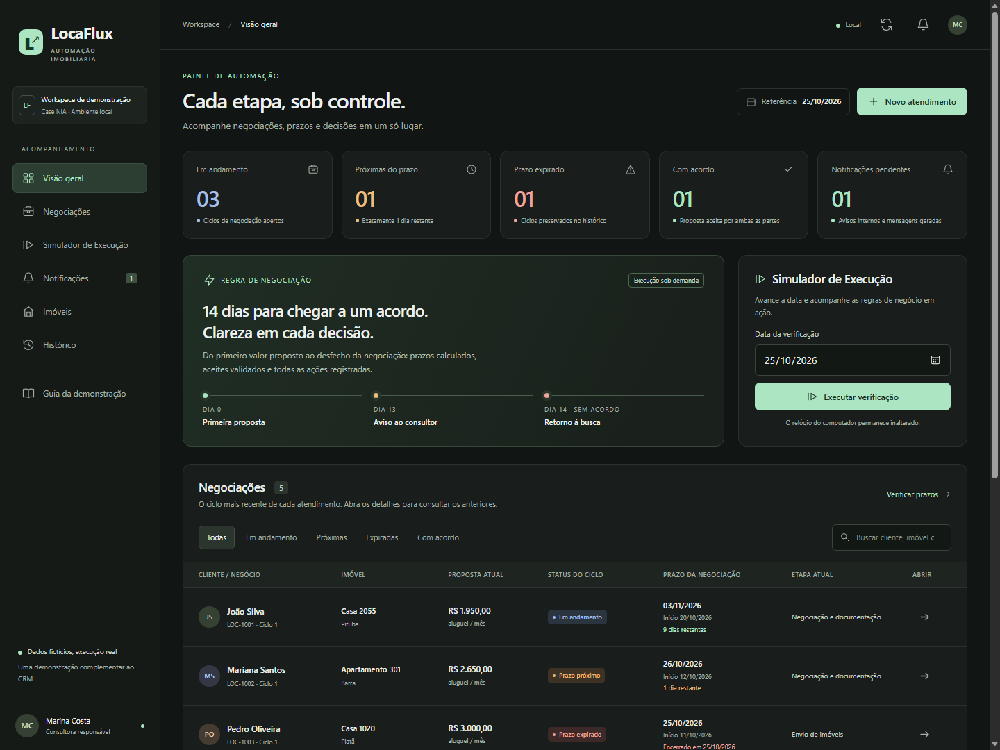

# LocaFlux · Case NIA

Demonstração **funcional e local** de automação do processo de locação para o case NIA, com motor de regras, histórico auditável, simulador de datas e persistência em JSON. Não há integração com Bitrix24 nem hospedagem configurada.



## Começar no Windows

Pré-requisito: **Node.js 24 ou superior**, com npm. O ambiente de validação utilizou Node.js **24.15.0** e npm **11.12.1**.

No PowerShell, na pasta do projeto:

```powershell
cd "C:\Users\valeu\Downloads\projetos\estagio desafio"
npm.cmd install
.\restaurar-demo.cmd
.\iniciar-demo.cmd
```

Abra **http://localhost:3000**. Encerre com `Ctrl+C`. Não há dependências de terceiros; a instalação apenas confere o pacote e seu lockfile. O servidor inicializa os dados se `data/store.json` ainda não existir.

```powershell
npm.cmd test
npm.cmd run verify -- --date 2026-11-02
npm.cmd run verify -- --date 2026-11-03
npm.cmd run reset
```

Use outro terminal para os comandos enquanto o servidor estiver aberto. `npm.cmd` evita depender da política de execução de scripts do PowerShell.

## Demonstração para gravação

1. Abra **Simulador de Execução**. O painel começa em **25/10/2026**, com cinco cenários fictícios. Para reiniciar, clique em **Restaurar demonstração → Restaurar dados iniciais**.
2. No cartão de **Ana Costa**, abra **Ver proposta e aceites**: cliente aceitou em 20/10 como autor e proprietário confirmou em 22/10 a mesma proposta de R$ 2.400,00. Feche os detalhes.
3. Selecione o atalho **02/11/2026** e clique em **Executar verificação**. João mostra **1 dia restante**. Abra seus detalhes → **Notificações** para mostrar o aviso ao consultor.
4. Feche os detalhes e execute **02/11/2026** novamente: **0 eventos criados · 0 notificações criadas**.
5. Selecione **03/11/2026** e execute: João, iniciado em 20/10, fica com **Prazo expirado** e retorna a **Envio de imóveis**. Em seus detalhes → **Notificações**, mostre a mensagem ao proprietário **Pendente de envio**.
6. Mostre separadamente Ana: **Acordo registrado**, etapa **Reunião e documentação**, os dois aceites preservados e nenhuma notificação de expiração. No log, o resultado é **Acordo válido: protegido contra expiração**.
7. Repita **03/11/2026**: zero eventos e notificações novos. Mostre condições, horário simulado, registro real, estados anterior/posterior e **Log completo da execução (JSON)**.
8. Recarregue a página para comprovar persistência. Use a restauração para começar novamente; o estado anterior fica em backup.

Roteiro com falas, contadores esperados e explicação dos outros três cenários: [docs/DEMONSTRACAO.md](docs/DEMONSTRACAO.md).

O simulador altera o estado persistido, sem modificar o relógio do computador. A referência não retrocede; a restauração recupera os cenários originais e faz backup do arquivo anterior.

## Documentação

- [Instalação, comandos e operação](docs/README.md)
- [Arquitetura, armazenamento, API e agendamento futuro](docs/ARQUITETURA.md)
- [Regras de negócio](docs/REGRAS_DE_NEGOCIO.md)
- [Cenários e roteiro de testes](docs/CENARIOS_DE_TESTE.md)
- [Relatório técnico para apresentação](docs/RELATORIO_TECNICO.md)
- [Evidências de validação](docs/evidencias/README.md)
- [Resultados reais dos testes desta entrega](docs/RESULTADOS_DOS_TESTES.md)
- [Preparação para publicar o código no GitHub](docs/GITHUB.md)

**Validação realizada:** 37 testes automatizados aprovados e fluxos exercitados no Microsoft Edge em desktop e telas móveis simuladas. A aplicação usa apenas recursos nativos do Node.js e do navegador.

As notificações externas são **mensagens geradas e pendentes**, sem envio de e-mail ou WhatsApp. Não há agendador configurado, execução garantida 24 horas, assinatura de contratos ou cobrança de aluguéis. Trello e o fluxograma obrigatório não fazem parte desta entrega.
